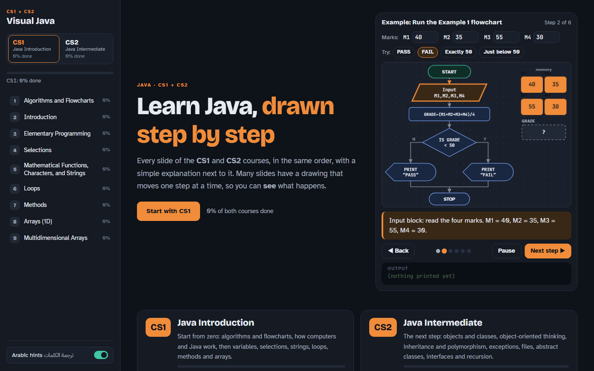
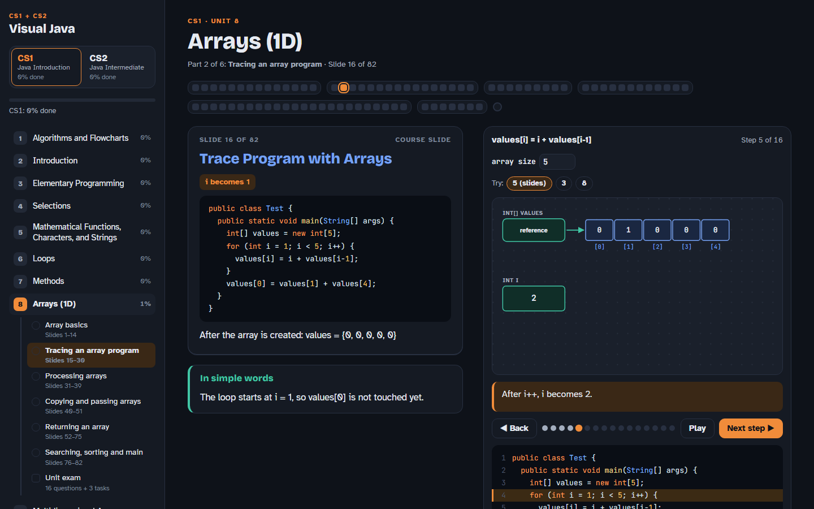
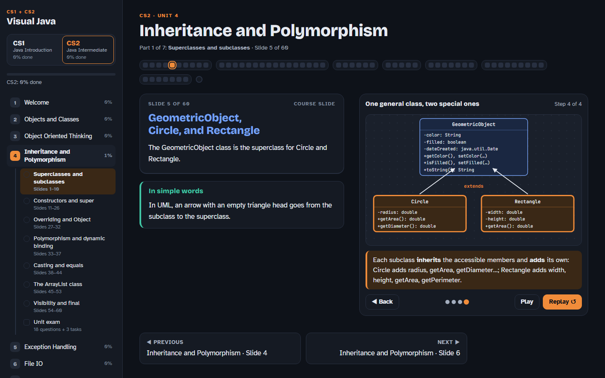

# Visual Java

**Learn Java from the CS1 and CS2 course slides, in simple English, with drawings that move step by step.**

Two courses in one website:

- **CS1 · Java Introduction**: 9 units, from algorithms and flowcharts to 2D arrays.
- **CS2 · Java Intermediate**: 9 units, from objects and classes to recursion.

The website follows the course slides **in the same order, one slide per page**. Next to every slide you get a short explanation in simple English and, for most slides, an interactive drawing. When you press **Next step**, the drawing, the highlighted code line and the program output move together, so you can *see* what Java does.

You don't need to install anything. It works in any modern browser, on a computer or a phone.



[العربية ⬇](#بالعربي)

---

## What is inside

**18 units · 738 slides · 227 interactive drawings · 710 questions · 17 unit exams**

### CS1 · Java Introduction

| Unit | Slides |
|---|---|
| 1. Algorithms and Flowcharts | 23 |
| 2. Introduction | 73 |
| 3. Elementary Programming | 47 |
| 4. Selections | 42 |
| 5. Mathematical Functions, Characters, and Strings | 38 |
| 6. Loops | 31 |
| 7. Methods | 51 |
| 8. Arrays (1D) | 82 |
| 9. Multidimensional Arrays | 20 |



### CS2 · Java Intermediate

| Unit | Slides |
|---|---|
| 1. Welcome | 7 |
| 2. Objects and Classes | 66 |
| 3. Object Oriented Thinking | 51 |
| 4. Inheritance and Polymorphism | 60 |
| 5. Exception Handling | 42 |
| 6. File IO | 25 |
| 7. Abstract Classes | 22 |
| 8. Interfaces | 33 |
| 9. Recursion | 25 |



### Features

- **The slides, nothing more and nothing less.** Every slide is shown with its text or its picture. The explanation never adds topics that are not in the slides.
- **Simple English.** Short sentences. Java words stay as they are: `class`, `extends`, `try`, `Scanner`...
- **Interactive drawings.** Flowcharts, memory boxes, arrays with their index, objects and references, UML class trees, exceptions moving to `catch`, the call stack in recursion and more. Many drawings let you change the input or pick a ready example (normal case, edge case, wrong input).
- **Arabic hints.** Hard English words have a dotted line. Point at one (or tap it on a phone) to see the Arabic meaning. You can turn the hints off.
- **A quick quiz after every part:** multiple choice, true/false, fill in the code, "what is the output?" and put-the-lines-in-order.
- **A unit exam** at the end of every unit: questions plus code-writing tasks with a checker and a solution. Every question links back to the slide you should review.
- **Your progress is saved** in your browser.
- **Light and dark mode**, following your system setting.
- **Keyboard:** ← and → change the slide, `.` and `,` move the drawing.

---

## How to run it

### Option 1: Download a ZIP file

1. On this page, click the green **Code** button.
2. Click **Download ZIP**.
3. Unzip (extract) the file.
4. Run a small local server inside the folder (see below), then open the page.

### Option 2: Clone with git

```bash
git clone https://github.com/drs-0/visual-java.git
cd visual-java
```

### Run a small local server

The page loads the slide data with `fetch`, so open it through a local server, not by double-clicking `index.html`:

```bash
python -m http.server 8000
```

Then open http://localhost:8000 in your browser.

> **Internet note:** the page loads its fonts from Google Fonts. Without internet it still works, but it uses your system fonts.

---

## Project structure

```
visual-java/
├── index.html                 the page: layout and all styles
├── js/
│   ├── app.js                 the engine: slides, drawings, code highlighting, quizzes, exams, progress
│   └── units/
│       ├── cs1/<unit>.js      one teaching file per CS1 unit
│       └── cs2/<unit>.js      one teaching file per CS2 unit
├── content/                   the slide data: manifest.json, lesson.json per unit, slide pictures
└── docs/                      screenshots for this README
```

No build step and no libraries. It is plain HTML, CSS and JavaScript.

### How a unit file looks

Each unit file calls `addUnit({...})`. The order of units and slides comes from `content/manifest.json`.

```js
addUnit({
  course: 'cs1', lesson: '06-loops', blurb: 'One line for the home page card',
  parts: [ { title: 'The while loop', from: 1, to: 9, quiz: [ /* questions */ ] } ],
  slides: {
    3: { explain: 'Simple English. Use {{word|ترجمة}} for an Arabic hint.' }
  },
  visuals: [{
    id: 'while', slides: [3, 6], title: 'Count to 3',
    code: 'int i = 1;\nwhile (i <= 3) {\n  System.out.println(i);\n  i++;\n}',
    steps: [ { cap: 'i starts at 1', line: 1 }, { cap: 'Print i', line: 3, out: '1' } ],
    draw: function (k, step) { return [ B('i', 40, 40, 120, 60, { title: 'int i', lines: ['1'] }) ]; }
  }],
  exam: { questions: [ /* each with review: slideNumber */ ], tasks: [ /* code tasks */ ] }
});
```

Shapes with the same `id` in two steps slide smoothly from the old place to the new one.

---

## Credits

The order and the topics follow the CS1 and CS2 Java course slides. The slide text and pictures belong to the course. The explanations, drawings, quizzes and exams in this project are written new, in simple English.

## License

The code is under the [MIT License](LICENSE). You can use it, change it and share it.

---

<div dir="rtl">

## بالعربي

**تعلّم Java من سلايدات كورس CS1 و CS2، بإنقليزي بسيط، مع رسومات تتحرك خطوة بخطوة.**

- **CS1 · Java Introduction**: 9 وحدات، من الخوارزميات والمخططات الانسيابية إلى الأراي الثنائية.
- **CS2 · Java Intermediate**: 9 وحدات، من الكلاسات والأوبجكتات إلى الـ recursion.

الموقع ماشي على نفس ترتيب السلايدات، **كل سلايد بصفحة**. جنب كل سلايد شرح بسيط، وأغلب السلايدات معها رسمة تفاعلية تتحرك مع الكود.

### المميزات

- **18 وحدة، 738 سلايد، 227 رسمة تفاعلية، 710 سؤال، و17 اختبار وحدة.**
- **نفس محتوى السلايدات بالضبط**: لا زيادة ولا نقص.
- **إنقليزي بسيط**، وأسماء Java باقية زي ما هي.
- **رسومات تتحرك**، وتقدر تغيّر المدخلات أو تختار أمثلة جاهزة (حالة عادية، حالة حدّية، مدخل غلط).
- **ترجمة عربية**: الكلمات الصعبة تحتها خط منقّط. وقف عليها بالماوس أو اضغط عليها بالجوال.
- **اختبار قصير** بعد كل جزء، و**اختبار وحدة** بآخر كل وحدة فيه أسئلة ومهام كتابة كود، وكل سؤال يوديك للسلايد اللي تراجعه.
- **يحفظ تقدمك** على المتصفح.

### طريقة التشغيل

1. نزّل المشروع (الزر الأخضر **Code** ثم **Download ZIP**) أو بـ `git clone`.
2. افتح المجلد وشغّل: `python -m http.server 8000`
3. افتح http://localhost:8000 بالمتصفح.

> **ملاحظة:** الخطوط تنزل من الإنترنت. إذا ما فيه نت، الموقع يشتغل عادي بس بخطوط الجهاز.

### تنبيه

ترتيب المواضيع ماشي على سلايدات كورس CS1 و CS2. نصوص السلايدات وصورها تابعة للكورس، أما الشرح والرسومات والأسئلة فمكتوبة من جديد.

</div>
