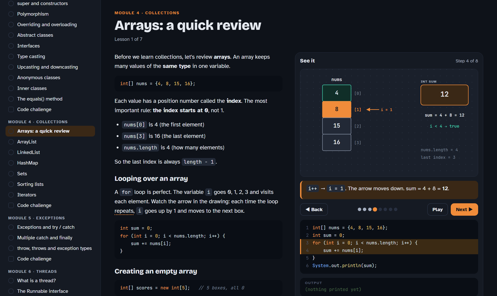

# Visual Java Intermediate

**Java Intermediate in simple English, with drawings that move step by step.**

Every lesson shows the explanation on one side and an animated drawing on the other side. When you press **Next**, the drawing, the highlighted code line and the program output move together, so you can *see* what Java does.

**▶ Open the course online:** https://drs-0.github.io/visual-java-intermediate/

You don't need to install anything. It works in any modern browser, on a computer or a phone.



[العربية ⬇](#بالعربي)

---

## What is inside

| Module | Lessons |
|---|---|
| 1. Methods | What is a method · Parameters · Return values · Overloading · Recursion |
| 2. Classes & Objects | Classes and objects · Attributes and behavior · Constructors · Access modifiers · Getters and setters · Value and reference types · `static` · The `Math` class · `final` · Packages |
| 3. OOP Concepts | The four OOP ideas · Inheritance · `super` and constructors · Polymorphism · Overriding vs overloading · Abstract classes · Interfaces · Type casting · Upcasting and downcasting · Anonymous classes · Inner classes · `equals()` |
| 4. Collections | Arrays review · `ArrayList` · `LinkedList` · `HashMap` · Sets · Sorting · Iterators |
| 5. Exceptions | `try` / `catch` · Multiple `catch` and `finally` · `throw`, `throws`, checked and unchecked |
| 6. Threads | What is a thread · `Runnable` · `sleep()` and `join()` |
| 7. Scanner & Files | `Scanner` input · The `File` class · Reading a file · Writing a file |

**44 lessons and 7 code challenges.**

### Features

- **Simple English.** Short sentences for learners at a middle level. Java words stay as they are: `class`, `extends`, `ArrayList`, `try`...
- **Step-by-step drawings.** Arrays with their index, class trees for inheritance, stack and heap memory, HashMap buckets, exceptions flying to `catch`, thread timelines and more.
- **Arabic hints.** Hard English words have a dotted line. Point at one (or tap it on a phone) to see the Arabic meaning. You can turn the hints off.
- **Quizzes** after every lesson: multiple choice and fill-in-the-blank code.
- **A code challenge** at the end of every module, with a checker and a solution.
- **Your progress is saved** in your browser.
- **Light and dark mode**, following your system setting.
- **Keyboard:** use the ← and → keys to move through the steps.

---

## How to download and use it

### Option 1: Use it online (easiest)

Open https://drs-0.github.io/visual-java-intermediate/ and start learning.

### Option 2: Download a ZIP file

1. On this page, click the green **Code** button.
2. Click **Download ZIP**.
3. Unzip (extract) the file.
4. Open the folder and double-click **`index.html`**. It opens in your browser.

### Option 3: Clone with git

```bash
git clone https://github.com/drs-0/visual-java-intermediate.git
cd visual-java-intermediate
```

Then open `index.html` in your browser.

### Optional: run a small local server

Opening `index.html` directly works. If your browser blocks something, run a local server from inside the folder:

```bash
python -m http.server 8000
```

Then open http://localhost:8000 in your browser.

> **Internet note:** the page loads its fonts from Google Fonts. Without internet it still works, but it uses your system fonts.

---

## Project structure

```
visual-java-intermediate/
├── index.html            the page: layout and all styles
├── js/
│   ├── app.js            the engine: drawings, code highlighting, quizzes, challenges, progress
│   ├── m1-methods.js     Module 1 lessons
│   ├── m2-classes.js     Module 2 lessons
│   ├── m3-oop.js         Module 3 lessons
│   ├── m4-collections.js Module 4 lessons
│   ├── m5-exceptions.js  Module 5 lessons
│   ├── m6-threads.js     Module 6 lessons
│   └── m7-files.js       Module 7 lessons
└── docs/screenshot.png
```

No build step and no libraries. It is plain HTML, CSS and JavaScript.

### Add or change a lesson

Each module file calls `addModule({...})`. A lesson looks like this:

```js
{
  id: 'm1-1',
  title: 'What is a method?',
  body: `<p>Text in HTML. Use {{word|ترجمة}} for an Arabic hint.</p>
~~~
code blocks go between ~~~ lines
~~~`,
  code: `the Java code shown next to the drawing`,
  steps: [
    { cap: 'What happens in this step', line: 3, out: 'printed text' }
  ],
  draw: function (k) {          // k = step number, returns the shapes for that step
    return [
      B('box', 30, 40, 200, 60, { title: 'main()', tone: 'blue' }),   // box
      T('txt', 30, 140, 'some text'),                                // text
      A('arr', 230, 70, 320, 70, { label: 'call' }),                 // arrow
      P('ptr', 100, 200, 'i = 0')                                    // pointer
    ];
  },
  quiz: [
    { q: 'Question?', options: ['A', 'B'], answer: 0, why: 'Because...' },
    { type: 'fill', q: 'Fill it in', code: 'int x = ___;', answer: ['5'] }
  ]
}
```

Shapes with the same `id` in two steps slide smoothly from the old place to the new one.

---

## Credits

The topics follow the outline of the Sololearn **Java Intermediate** course. All lessons, drawings and questions in this project are written new, in simple English. This project is not made by Sololearn and is not connected to Sololearn.

## License

The code is under the [MIT License](LICENSE). You can use it, change it and share it.

---

<div dir="rtl">

## بالعربي

**كورس Java Intermediate بإنقليزي بسيط، مع رسومات تتحرك خطوة بخطوة.**

كل درس فيه الشرح على جهة والرسمة على الجهة الثانية. كل ما تضغط **Next** تتحرك الرسمة، ويتلوّن سطر الكود اللي يشتغل، ويطلع الـ Output.

**▶ افتح الكورس أونلاين:** https://drs-0.github.io/visual-java-intermediate/

ما يحتاج تثبّت أي شي. يشتغل على أي متصفح، بالكمبيوتر أو بالجوال، ومتى ما تبي.

### المميزات

- **إنقليزي بسيط**، وأسماء Java باقية زي ما هي.
- **رسومات تتحرك**: الأراي مع الـ index، شجرة الكلاسات بالـ inheritance، الذاكرة، الـ HashMap، الـ exceptions، الـ threads وغيرها.
- **ترجمة عربية**: الكلمات الصعبة تحتها خط منقّط. وقف عليها بالماوس أو اضغط عليها بالجوال وتطلع ترجمتها.
- **أسئلة** بعد كل درس، و**تحدي كود** بآخر كل قسم.
- **يحفظ تقدمك** على المتصفح.

### طريقة التنزيل

**الطريقة 1، الأسهل:** افتح الرابط فوق وابدأ على طول.

**الطريقة 2، تنزيل ZIP:**
1. اضغط الزر الأخضر **Code** بأعلى الصفحة.
2. اختر **Download ZIP**.
3. فك الضغط عن الملف.
4. افتح المجلد واضغط مرتين على **`index.html`**. بيفتح لك بالمتصفح.

**الطريقة 3، بـ git:**

```bash
git clone https://github.com/drs-0/visual-java-intermediate.git
```

بعدها افتح `index.html` بالمتصفح.

> **ملاحظة:** الخطوط تنزل من الإنترنت. إذا ما فيه نت، الموقع يشتغل عادي بس بخطوط الجهاز.

### تنبيه

المواضيع ماشية على نفس ترتيب كورس Java Intermediate حق Sololearn، بس كل الشرح والرسومات والأسئلة مكتوبة من جديد. المشروع مو تابع لـ Sololearn.

</div>
