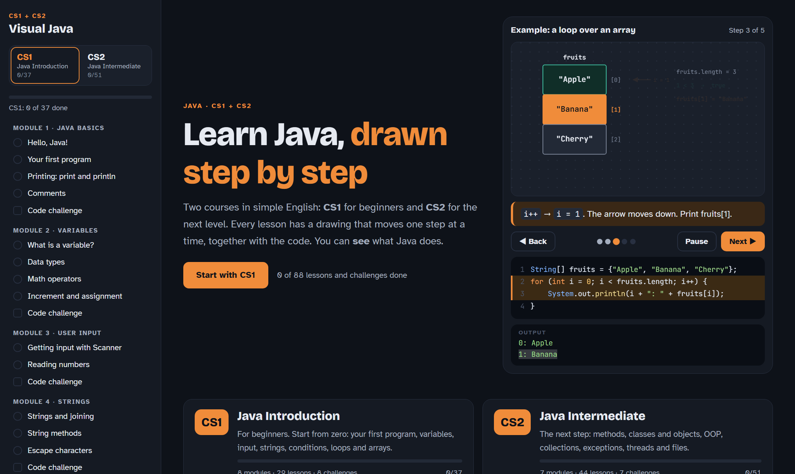
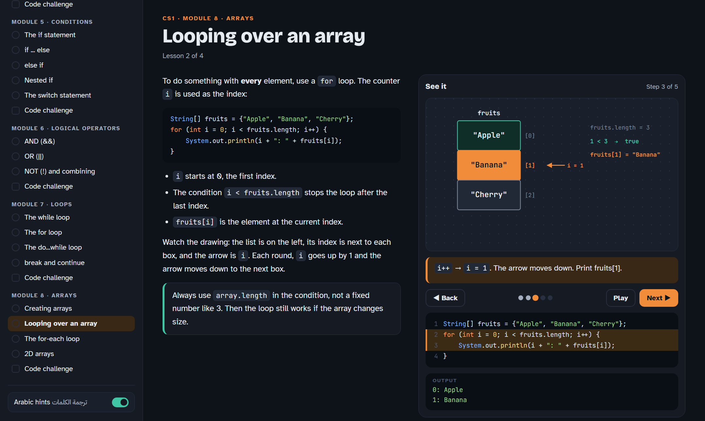
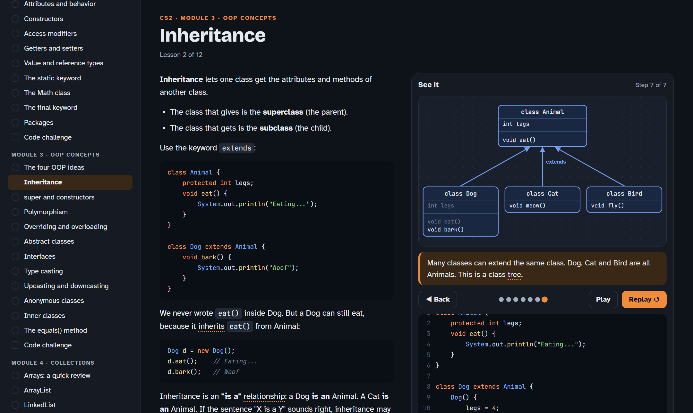

# Visual Java

**Learn Java in simple English, with drawings that move step by step.**

Two courses in one website:

- **CS1 · Java Introduction**: for beginners. Start from zero.
- **CS2 · Java Intermediate**: the next level, after CS1.

Every lesson shows the explanation on one side and an animated drawing on the other side. When you press **Next**, the drawing, the highlighted code line and the program output move together, so you can *see* what Java does.

**▶ Open the course online:** https://drs-0.github.io/visual-java/

You don't need to install anything. It works in any modern browser, on a computer or a phone.



[العربية ⬇](#بالعربي)

---

## What is inside

**73 lessons and 15 code challenges.** In the menu on the left, choose **CS1** or **CS2**.

### CS1 · Java Introduction (8 modules, 29 lessons)

| Module | Lessons |
|---|---|
| 1. Java Basics | Hello, Java! · Your first program · `print` and `println` · Comments |
| 2. Variables | What is a variable · Data types · Math operators · Increment and assignment |
| 3. User Input | Getting input with `Scanner` · Reading numbers |
| 4. Strings | Strings and joining · String methods · Escape characters |
| 5. Conditions | `if` · `if ... else` · `else if` · Nested `if` · `switch` |
| 6. Logical Operators | AND `&&` · OR `\|\|` · NOT `!` and combining |
| 7. Loops | `while` · `for` · `do ... while` · `break` and `continue` |
| 8. Arrays | Creating arrays · Looping over an array · for-each · 2D arrays |



### CS2 · Java Intermediate (7 modules, 44 lessons)

| Module | Lessons |
|---|---|
| 1. Methods | What is a method · Parameters · Return values · Overloading · Recursion |
| 2. Classes & Objects | Classes and objects · Attributes and behavior · Constructors · Access modifiers · Getters and setters · Value and reference types · `static` · The `Math` class · `final` · Packages |
| 3. OOP Concepts | The four OOP ideas · Inheritance · `super` and constructors · Polymorphism · Overriding vs overloading · Abstract classes · Interfaces · Type casting · Upcasting and downcasting · Anonymous classes · Inner classes · `equals()` |
| 4. Collections | Arrays review · `ArrayList` · `LinkedList` · `HashMap` · Sets · Sorting · Iterators |
| 5. Exceptions | `try` / `catch` · Multiple `catch` and `finally` · `throw`, `throws`, checked and unchecked |
| 6. Threads | What is a thread · `Runnable` · `sleep()` and `join()` |
| 7. Scanner & Files | `Scanner` input · The `File` class · Reading a file · Writing a file |



### Features

- **Simple English.** Short sentences for learners at a middle level. Java words stay as they are: `class`, `extends`, `ArrayList`, `try`...
- **Step-by-step drawings.** Arrays with their index, flowcharts for `if` and loops, circuits for `&&` and `||`, class trees, stack and heap memory, HashMap buckets, exceptions flying to `catch`, thread timelines and more.
- **Arabic hints.** Hard English words have a dotted line. Point at one (or tap it on a phone) to see the Arabic meaning. You can turn the hints off.
- **Quizzes** after every lesson: multiple choice and fill-in-the-blank code.
- **A code challenge** at the end of every module, with a checker and a solution.
- **One path:** the last lesson of CS1 leads straight into CS2.
- **Your progress is saved** in your browser, for each course.
- **Light and dark mode**, following your system setting.
- **Keyboard:** use the ← and → keys to move through the steps.

---

## How to download and use it

### Option 1: Use it online (easiest)

Open https://drs-0.github.io/visual-java/ and start learning.

### Option 2: Download a ZIP file

1. On this page, click the green **Code** button.
2. Click **Download ZIP**.
3. Unzip (extract) the file.
4. Open the folder and double-click **`index.html`**. It opens in your browser.

### Option 3: Clone with git

```bash
git clone https://github.com/drs-0/visual-java.git
cd visual-java
```

Then open `index.html` in your browser.

### Optional: run a small local server

Opening `index.html` directly works. If your browser blocks something, run a local server from inside the folder:

```bash
python -m http.server 8000
```

Then open http://localhost:8000 in your browser.

> **Internet note:** the page loads its fonts from Google Fonts. Without internet it still works, but it uses your system fonts.

---

## Project structure

```
visual-java/
├── index.html              the page: layout and all styles
├── js/
│   ├── app.js              the engine: drawings, code highlighting, quizzes, challenges, progress, CS1/CS2 tabs
│   ├── cs1-basics.js       CS1 Module 1
│   ├── cs1-variables.js    CS1 Module 2
│   ├── cs1-input.js        CS1 Module 3
│   ├── cs1-strings.js      CS1 Module 4
│   ├── cs1-conditions.js   CS1 Module 5
│   ├── cs1-logic.js        CS1 Module 6
│   ├── cs1-loops.js        CS1 Module 7
│   ├── cs1-arrays.js       CS1 Module 8
│   ├── m1-methods.js       CS2 Module 1
│   ├── m2-classes.js       CS2 Module 2
│   ├── m3-oop.js           CS2 Module 3
│   ├── m4-collections.js   CS2 Module 4
│   ├── m5-exceptions.js    CS2 Module 5
│   ├── m6-threads.js       CS2 Module 6
│   └── m7-files.js         CS2 Module 7
└── docs/                   screenshots for this README
```

No build step and no libraries. It is plain HTML, CSS and JavaScript.

### Add or change a lesson

Each module file calls `addModule({...})`. Set `track: 'cs1'` or `track: 'cs2'` to choose the course. A lesson looks like this:

```js
{
  id: 'c1-1',
  title: 'Hello, Java!',
  body: `<p>Text in HTML. Use {{word|ترجمة}} for an Arabic hint.</p>
~~~
code blocks go between ~~~ lines
~~~`,
  code: `the Java code shown next to the drawing`,
  steps: [
    { cap: 'What happens in this step', line: 3, out: 'printed text' }
  ],
  draw: function (k) {          // k = step number, returns the shapes for that step
    return [
      B('box', 30, 40, 200, 60, { title: 'main()', tone: 'blue' }),      // box
      B('if', 200, 30, 180, 90, { shape: 'diamond', title: 'x > 0 ?' }), // flowchart diamond
      T('txt', 30, 140, 'some text'),                                   // text
      A('arr', 230, 70, 320, 70, { label: 'call' }),                    // arrow
      P('ptr', 100, 200, 'i = 0')                                       // pointer
    ];
  },
  quiz: [
    { q: 'Question?', options: ['A', 'B'], answer: 0, why: 'Because...' },
    { type: 'fill', q: 'Fill it in', code: 'int x = ___;', answer: ['5'] }
  ]
}
```

Shapes with the same `id` in two steps slide smoothly from the old place to the new one.

---

## Credits

The topics follow the outlines of the Sololearn courses **Introduction to Java** (CS1) and **Java Intermediate** (CS2). All lessons, drawings and questions in this project are written new, in simple English. This project is not made by Sololearn and is not connected to Sololearn.

## License

The code is under the [MIT License](LICENSE). You can use it, change it and share it.

---

<div dir="rtl">

## بالعربي

**تعلّم Java بإنقليزي بسيط، مع رسومات تتحرك خطوة بخطوة.**

كورسين في موقع واحد:

- **CS1 · Java Introduction**: للمبتدئين، تبدأ من الصفر.
- **CS2 · Java Intermediate**: المستوى اللي بعده.

من القائمة اللي على اليسار تختار **CS1** أو **CS2**. وآخر درس في CS1 يوديك على طول لأول درس في CS2.

**▶ افتح الكورس أونلاين:** https://drs-0.github.io/visual-java/

ما يحتاج تثبّت أي شي. يشتغل على أي متصفح، بالكمبيوتر أو بالجوال، ومتى ما تبي.

### المميزات

- **73 درس و 15 تحدي كود.**
- **إنقليزي بسيط**، وأسماء Java باقية زي ما هي.
- **رسومات تتحرك:**
  - أراي جنب كل خانة الـ index حقها، وفيه سهم ينزل كل ما يزيد `i`.
  - مخططات انسيابية للـ `if` واللوبات.
  - دوائر كهربائية للـ `&&` و `||`.
  - شجرة الكلاسات للـ inheritance، والذاكرة، والـ HashMap، وغيرها.
- **ترجمة عربية**: الكلمات الصعبة تحتها خط منقّط. وقف عليها بالماوس أو اضغط عليها بالجوال وتطلع ترجمتها.
- **أسئلة** بعد كل درس، و**تحدي كود** بآخر كل قسم.
- **يحفظ تقدمك** على المتصفح.

### طريقة التنزيل

**الطريقة 1، الأسهل:** افتح الرابط فوق وابدأ على طول.

**الطريقة 2، تنزيل ZIP:**
1. اضغط الزر الأخضر **Code** بأعلى الصفحة.
2. اختر **Download ZIP**.
3. فك الضغط عن الملف.
4. افتح المجلد واضغط مرتين على **`index.html`**. بيفتح لك بالمتصفح.

**الطريقة 3، بـ git:**

```bash
git clone https://github.com/drs-0/visual-java.git
```

بعدها افتح `index.html` بالمتصفح.

> **ملاحظة:** الخطوط تنزل من الإنترنت. إذا ما فيه نت، الموقع يشتغل عادي بس بخطوط الجهاز.

### تنبيه

المواضيع ماشية على نفس ترتيب كورسات Sololearn، وهي Introduction to Java و Java Intermediate. بس كل الشرح والرسومات والأسئلة مكتوبة من جديد. المشروع مو تابع لـ Sololearn.

</div>
